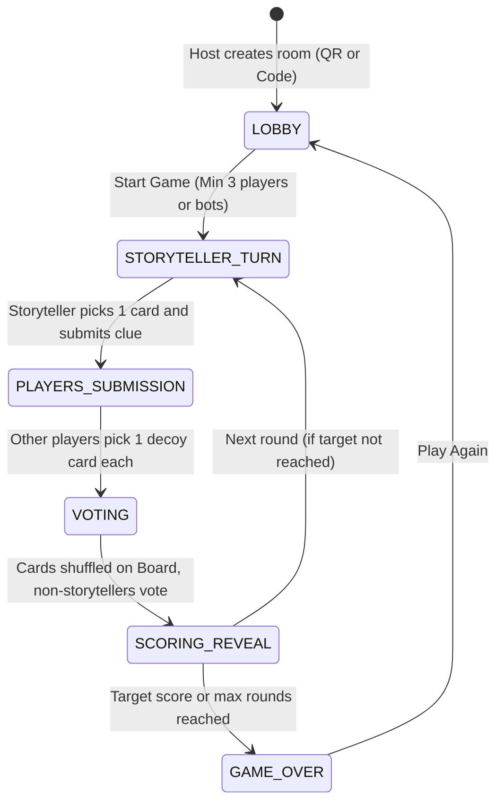

# 🎨 pixAIt — AI-Powered Multiplayer Storytelling Card Game

> **Software Quality and Project Development (A.Y. 2026/2027)** — University of Catania (`unict-sqpd`, `unict-sqpd-2026-2027`)

**pixAIt** is a smart, web-based multiplayer visual storytelling and social deduction card game designed around a **dual-screen party experience**. Players gather around a **Central Board** (displayed on a laptop, TV, or projector) and connect using their **smartphones** as private controllers to play illustrated cards, craft enigmatic clues, and vote in real time—enhanced by **generative AI decks** and **intelligent AI bot players**.

---

## ✨ Key Features

### 1. 🖥️ + 📱 Dual-Screen Party Experience

- **Central Shared Board (Desktop / TV / Projector):** Displays the room code and join QR code, active storyteller clue, shuffled card reveals, voting animations, and the live score track.
- **Mobile Player Controller (Smartphone / Tablet):** Provides each player with a private, touch-friendly view of their secret hand of cards, a clue submission prompt when acting as the Storyteller, and an interactive voting pad.
- **Zero-Friction Onboarding:** No account registration required. Players scan a **QR Code** or enter a **4-letter Room Code**, pick a nickname and avatar, and join the lobby in seconds.

### 2. 🤖 Smart AI Integration

- **AI Bot Players (`PixAI`):** Since social deduction card mechanics require at least 3–4 participants to keep voting unpredictable, hosts can add **AI Bot Players** to any lobby. Bots can:
  - Act as the **Storyteller**, generating creative, lateral-thinking clues from a card's visual description.
  - Act as **Guessers**, selecting the most semantically fitting decoy card from their hand and voting on revealed cards.
- **AI Dream Deck Generator:** Alongside a curated built-in deck (for instant offline and CI play), players can generate custom thematic card decks on the fly (e.g., *Cyberpunk Sicily*, *Pixel Art Mythology*, *Baroque Dreams*) powered by generative AI and persisted in the database.

### 3. 🃏 Custom Decks & Card Collection

- **In-Game Card Download & Export:** Players can download favorite cards as they are played during a match or export full decks compiled from past game sessions.
- **Custom Deck Import:** Hosts can import custom card decks—whether saved from previous matches or downloaded online—directly into a lobby to play with personalized or community-created card collections.

### 4. ⚡ Configurable Match Modes

- **Classic Mode:** First player to reach **30 points** wins.
- **Quick Match Mode:** Configurable number of rounds (e.g., 3 or 5 rounds) for fast casual sessions, live demonstrations, and automated E2E testing.

---

## 🎲 Game Flow & Scoring Rules

### Scoring Logic

- **Balanced Clue (Some—but not all—players guess the Storyteller's card):**
  - **Storyteller:** `+3 points`
  - **Each player who guessed correctly:** `+3 points`
- **Too Easy or Too Hard (All players or NO players guess the Storyteller's card):**
  - **Storyteller:** `0 points`
  - **All other players:** `+2 points`
- **Deception Bonus:**
  - Every non-storyteller receives **`+1 bonus point`** for each vote cast on their decoy card.

---

## 🏗️ High-Level Architecture

The system combines a static, globally accessible web frontend with a containerized Python backend for real-time state synchronization, persistence, and AI integration:

1. **Web Frontend (Hosted on GitHub Pages):**
   - Responsive Single-Page Application (SPA) serving both the **Board View** (`/board/:roomCode`) and the **Mobile Controller View** (`/play/:roomCode`).
   - Built and deployed automatically via GitHub Actions to **GitHub Pages**.
2. **Real-Time Game Backend (Python & Docker):**
   - Authoritative game engine managing room state machines, player sessions, real-time WebSocket synchronization, deck persistence, and external AI service calls.
   - Packaged as a multi-architecture Docker image and published automatically to **GitHub Container Registry (`ghcr.io`)**.
3. **Persistence & External Services:**
   - **Database:** Stores card decks, AI-generated cards, and match history.
   - **AI Service Layer:** Interfaces with external LLM / Image Generation APIs with a deterministic mock fallback for offline development and CI pipelines.

---

## 🔮 Future Developments

- **Freehand Mobile Card Drawing:** Allow players to sketch and paint their own cards directly on their smartphone screen instead of drawing from a pre-existing deck.
- **In-Match AI Card Crafting (Sketch-to-Card & Prompt-to-Card):** Enable players to generate custom cards live during a match starting from a quick hand-drawn sketch or a text prompt, transforming rough doodles or ideas into surreal playable artwork on the fly.

---

## 👥 Authors

- **Nicolò Cacciola** — GitHub: [@nickcacci](https://github.com/nickcacci)
- **Paolo Scarlata** — GitHub: [@ZGr3Y](https://github.com/ZGr3Y)
