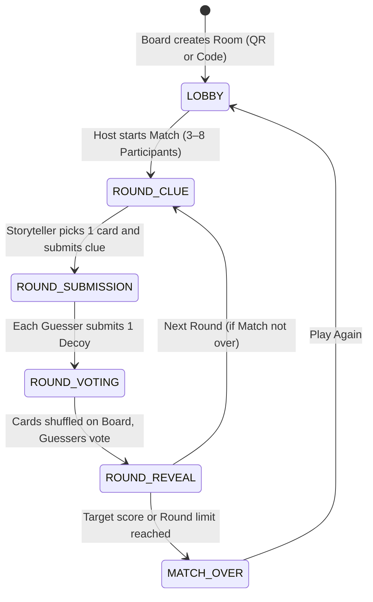

# 🎨 pixAIt — AI-Powered Multiplayer Storytelling Card Game

> **Software Quality and Project Development (A.Y. 2026/2027)** — University of Catania (`unict-sqpd`, `unict-sqpd-2026-2027`)

**pixAIt** is a smart, web-based multiplayer visual storytelling and social deduction card game designed around a **dual-screen party experience**. Participants gather around a **Board** (displayed on a laptop, TV, or projector) and Players connect using their **smartphones** as private controllers to play illustrated cards, craft enigmatic clues, and vote in real time—enhanced by **generative AI decks** and **AI Bots**.

> The project's domain vocabulary (Room, Match, Round, Participant, Bot, …) is defined in [GLOSSARY.md](./GLOSSARY.md).

---

## ✨ Key Features

### 1. 🖥️ + 📱 Dual-Screen Party Experience

- **Board (Desktop / TV / Projector):** Creates the Room and displays the Room code and join QR code, the active Storyteller's clue, shuffled card reveals, voting animations, and the live score track. The Board is a shared display, never a Participant.
- **Mobile Player Controller (Smartphone / Tablet):** Provides each Player with a private, touch-friendly view of their secret Hand, a clue submission prompt when acting as the Storyteller, and an interactive voting pad.
- **Zero-Friction Onboarding:** No account registration required. Players scan a **QR Code** or enter a **4-letter Room Code**, pick a nickname and avatar, and join the Room in seconds. The first Player to join becomes the **Host**, who configures and starts the Match.

### 2. 🤖 Smart AI Integration

- **Bots:** Since social deduction card mechanics require at least 3 Participants to keep voting unpredictable, the Host can add **Bots** (default display name `PixAI`) while the Room is in its lobby phase. Bots can:
  - Act as the **Storyteller**, generating creative, lateral-thinking clues from a card's text description.
  - Act as **Guessers**, selecting the most semantically fitting Decoy from their Hand and voting on revealed cards.
- **AI Dream Deck Generator:** Alongside a curated built-in deck (for instant offline and CI play), players can generate custom thematic card decks (e.g., *Cyberpunk Sicily*, *Pixel Art Mythology*, *Baroque Dreams*) powered by generative AI and persisted in the database.

### 3. 🃏 Custom Decks & Card Collection

- **In-Game Card Download & Export:** Players can download favorite cards as they are played during a Match or export full decks compiled from past Matches.
- **Custom Deck Import:** The Host can import custom card decks—whether saved from previous Matches or downloaded online—into the Room during its lobby phase, to play with personalized or community-created card collections.

### 4. ⚡ Configurable Match Modes

- **Classic:** The Match ends at the end of the first Round in which a Participant reaches **30 points**. The highest score wins; a tie is a shared win.
- **Quick Match:** The Match ends after a configurable number of Rounds (e.g., 3 or 5), skipped Rounds included, for fast casual sessions, live demonstrations, and automated E2E testing. Same winner rule as Classic.

---

## 🎲 Match Flow & Scoring Rules

A Match has **3 to 8 Participants** (Players and Bots), including at least one human Player. Each Participant holds a Hand of 6 cards, refilled after every Round, and the Storyteller role rotates in join order.

### Scoring Logic

- **Balanced Clue (Some—but not all—Guessers find the Storyteller's card):**
  - **Storyteller:** `+3 points`
  - **Each Guesser who found it:** `+3 points`
- **Too Easy or Too Hard (All Guessers or no Guesser find the Storyteller's card):**
  - **Storyteller:** `0 points`
  - **Every Guesser:** `+2 points`
- **Deception Bonus:**
  - Every Guesser receives **`+1 bonus point`** for each vote cast on their Decoy.

---

## 🏗️ High-Level Architecture

The system combines a static, globally accessible web frontend with a containerized Python backend for real-time state synchronization, persistence, and AI integration:

1. **Web Frontend (Hosted on GitHub Pages):**
   - Responsive Single-Page Application (SPA) serving both the **Board View** (`/board/:roomCode`) and the **Mobile Controller View** (`/play/:roomCode`).
   - Built and deployed automatically via GitHub Actions to **GitHub Pages**.
2. **Real-Time Game Backend (Python & Docker):**
   - Authoritative game engine managing Room and Match state machines, Player sessions, real-time WebSocket synchronization, deck persistence, and external AI service calls.
   - Packaged as a multi-architecture Docker image and published automatically to **GitHub Container Registry (`ghcr.io`)**.
3. **Persistence & External Services:**
   - **Database:** Stores card decks, AI-generated cards, and Match history.
   - **AI Service Layer:** Interfaces with external LLM / Image Generation APIs with a deterministic mock fallback for offline development and CI pipelines.

---

## 🔮 Future Developments

- **Freehand Mobile Card Drawing:** Allow players to sketch and paint their own cards directly on their smartphone screen instead of drawing from a pre-existing deck.
- **In-Match AI Card Crafting (Sketch-to-Card & Prompt-to-Card):** Enable players to generate custom cards live during a Match starting from a quick hand-drawn sketch or a text prompt, transforming rough doodles or ideas into surreal playable artwork on the fly.

---

## 👥 Authors

- **Nicolò Cacciola** — GitHub: [@nickcacci](https://github.com/nickcacci)
- **Paolo Scarlata** — GitHub: [@ZGr3Y](https://github.com/ZGr3Y)
